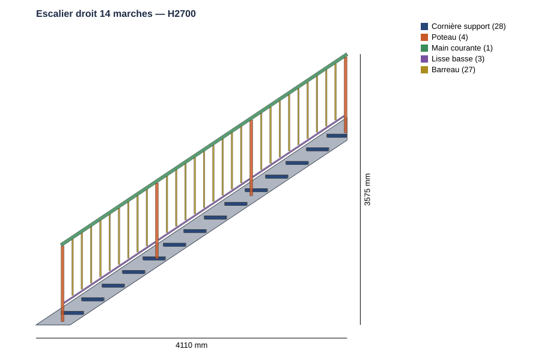
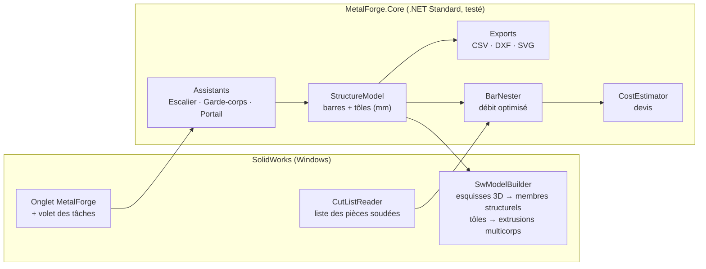

# 🔩 MetalForge — complément SolidWorks pour la métallerie-serrurerie

Complément (add-in) **Windows / SolidWorks** qui apporte les fonctions métier d'un logiciel de métallerie
(type MetalCAD, HiCAD Serrurerie, TopSolid'Steel…) directement dans SolidWorks :
escaliers, garde-corps, portails, débit optimisé des barres, nomenclature et devis.

> ℹ️ Les fonctionnalités exactes de MetalCAD ne sont pas documentées publiquement. Le périmètre retenu
> couvre les fonctions **cœur de métier** communes à ces logiciels (voir tableau ci-dessous) ; il est conçu pour
> être étendu module par module.



---

## ✨ Fonctionnalités

| Module | Ce qu'il fait | Sorties |
|---|---|---|
| 🪜 **Escalier droit** | Nombre de marches, hauteur/giron, **loi de Blondel** (2h+g), reculement imposé ou calculé, **échappée** sous trémie, limons tôle (contour exact) ou profilés (UPN, tubes), cornières support | Pièce mécano-soudée 3D, **DXF de traçage du limon**, rapport de conformité |
| 🛡️ **Garde-corps** | Droit ou **rampant**, pose à la française / à l'anglaise, entraxe poteaux, barreaudage ou lisses, vides **≤ 110 mm**, platines | Pièce 3D, vérifs **NF P01-012** |
| 🚪 **Portail / clôture** | Battant 1 ou 2 vantaux, **coulissant autoportant** (queue + écharpe), panneau de clôture, traverses, barreaux traversants, piliers | Pièce 3D, masse par vantail (gonds, motorisation) |
| ✂️ **Débit optimisé** | Optimisation 1D des barres (Best Fit Decreasing), trait de scie, équerrage, **réemploi des chutes** en stock, alerte aboutage | Plan de débit, CSV atelier |
| 📋 **Liste des pièces soudées** | Lecture de la cut-list SolidWorks de **n'importe quelle pièce mécano-soudée** (même non créée par MetalForge), reconnaissance automatique des profils | Débit + devis du modèle actif |
| 💶 **Devis** | Matière achetée (chutes incluses), tôle + laser, temps de coupe/soudure/meulage, peinture / thermolaquage / galva, pose, marge, TVA | Estimation détaillée HT/TTC |
| 📚 **Bibliothèque de profilés** | 123 profilés : tubes EN 10219, ronds, plats, cornières, fers T, UPN, IPE, HEA + tout identifiant bien formé (`TR90x45x3`) | Masse linéique, surface à peindre, fichier `.sldlfp` associé |
| 📐 **Exports** | Nomenclature CSV (Excel FR), DXF R12 (vue de face, limon), SVG | Fichiers prêts pour l'atelier / la découpe |

Toutes les fenêtres recalculent **en direct** : on modifie un paramètre → aperçu, conformité, débit et prix se mettent à jour.

| Garde-corps rampant | Portail coulissant autoportant |
|---|---|
|  |  |

---

## 🧱 Architecture



- **`MetalForge.Core`** — tout le calcul métier, sans dépendance à SolidWorks : testable, réutilisable
  (application autonome, service web…). **42 tests unitaires.**
- **`MetalForge.SwAddin`** — le complément COM (.NET Framework 4.8, x64) : commandes, fenêtres WinForms,
  génération de la géométrie via l'API SolidWorks.

Repère utilisé : **X** = longueur / sens de montée, **Y** = vertical, **Z** = profondeur. Cotes en **mm**.

```
 src/
 ├─ MetalForge.Core/
 │   ├─ Profiles/      catalogue, masses EN, reconnaissance des noms SolidWorks
 │   ├─ Stairs/        escalier droit (Blondel, échappée, limons)
 │   ├─ Railings/      garde-corps (NF P01-012)
 │   ├─ Gates/         portails, clôtures
 │   ├─ Fabrication/   débit optimisé
 │   ├─ Costing/       devis
 │   └─ Export/        CSV, DXF, SVG
 └─ MetalForge.SwAddin/
     ├─ MetalForgeAddin.cs   point d'entrée ISwAddin, onglet, volet des tâches
     ├─ Sw/                  génération 3D, lecture de la liste des pièces soudées
     ├─ UI/                  fenêtres (paramètres, aperçu, débit, devis)
     ├─ Settings/            réglages (%APPDATA%\MetalForge\settings.xml)
     └─ Install/             register.bat / unregister.bat
 tests/MetalForge.Core.Tests/
```

---

## 🛠️ Installation

**Prérequis** : Windows 10/11 x64, SolidWorks 2018 ou plus récent, Visual Studio 2022 (ou SDK .NET 8 + targeting pack .NET Framework 4.8).

1. **Compiler** (SolidWorks installé à l'emplacement par défaut) :
   ```bat
   dotnet build MetalForge.sln -c Release
   ```
   Autre dossier d'installation :
   `dotnet build MetalForge.sln -c Release -p:SolidWorksDir="D:\SOLIDWORKS Corp\SOLIDWORKS"`
2. **Enregistrer** : clic droit sur `src\MetalForge.SwAddin\bin\Release\net48\register.bat` → *Exécuter en tant qu'administrateur*.
3. **Activer** : SolidWorks → *Outils > Compléments* → cocher **MetalForge** (et « Démarrage »).
4. **Réglages** (onglet MetalForge → *Réglages*) : vérifier le **dossier des profils mécano-soudés**
   (détecté automatiquement depuis *Options > Emplacements des fichiers*).

Désinstallation : `unregister.bat` en administrateur, SolidWorks fermé.

---

## 🚀 Utilisation

1. Onglet **MetalForge** (ou volet des tâches) → **Escalier**, **Garde-corps** ou **Portail**.
2. Renseigner les paramètres à gauche ; l'aperçu, le rapport de conformité, le plan de débit et le devis se mettent à jour.
3. **Générer dans SolidWorks** → nouvelle pièce mécano-soudée : un membre structurel par profilé, les tôles en corps séparés,
   la liste des pièces soudées est prête pour la mise en plan.
4. **Débit & devis** sur n'importe quelle pièce mécano-soudée ouverte : lecture de la liste des pièces soudées → barres optimisées.

### Profils SolidWorks

La géométrie est créée avec les fichiers de profils `.sldlfp` de votre bibliothèque. MetalForge les reconnaît
automatiquement par leur nom (`square tube\40 x 40 x 4.sldlfp` → `TC40x40x4`, `Tube carré 40x40x2`, `UPN 120`…).
Si un profil manque :

- l'esquisse 3D `MF_<profil>` est **quand même créée** → insérer le membre à la main, ou
- créer le profil (*Bibliothèque de conception > weldments*) et/ou l'associer dans *Réglages > Associations manuelles*.

La fenêtre **Profilés** indique pour chaque profilé s'il est trouvé (✓) ou non (✗).

---

## ⚖️ Règles vérifiées

| Ouvrage | Règle | Référence |
|---|---|---|
| Escalier | 600 ≤ 2h + g ≤ 650 mm | Loi de Blondel |
| Escalier habitation | h 150–200 mm, g ≥ 240 mm (210 mini), emmarchement ≥ 800 mm, pente ≤ 42° | Usages / DTU |
| Escalier ERP | h ≤ 160 mm, g ≥ 280 mm, largeur ≥ 1 200 mm | Arrêté du 20/04/2017 |
| Escalier industriel | pente 30–45°, largeur ≥ 600 mm | NF E 85-015 *(à confirmer selon l'édition)* |
| Escalier | échappée ≥ 2 000 mm (1 900 toléré) | Usage |
| Garde-corps | H ≥ 1 000 mm (900 en rampant), vides ≤ 110 mm, jeu bas ≤ 110 mm, escaladabilité | NF P01-012 |
| Portail | vides barreaux, masse vantail, queue autoportant ≥ 40 % | Bonne pratique, NF EN 12453 si motorisé |

> ⚠️ Ces contrôles sont une **aide à la conception**. Ils ne remplacent ni la lecture des normes en vigueur,
> ni une note de calcul de résistance (poussée sur garde-corps NF P06-111-2, flèche des limons, etc.).

---

## 🧪 Tests

```bash
dotnet test tests/MetalForge.Core.Tests
```

Le moteur (`MetalForge.Core`) est testé sur Linux/Windows/macOS (intégration continue GitHub Actions).
Le complément SolidWorks nécessite Windows et une licence SolidWorks pour être exécuté.

---

## 🗺️ Évolutions prévues

- Escaliers **quart tournant / hélicoïdaux**, paliers, marches balancées
- Garde-corps **vitrés** (pinces, profils U) et câbles inox
- **Mise en plan automatique** (vues, nomenclature, bulles) et fiches de débit PDF
- Export **DSTV/NC1** pour scies et lignes de perçage CNC
- Génération automatique des fichiers `.sldlfp` manquants
- Assemblages multi-ouvrages et chiffrage d'affaire
