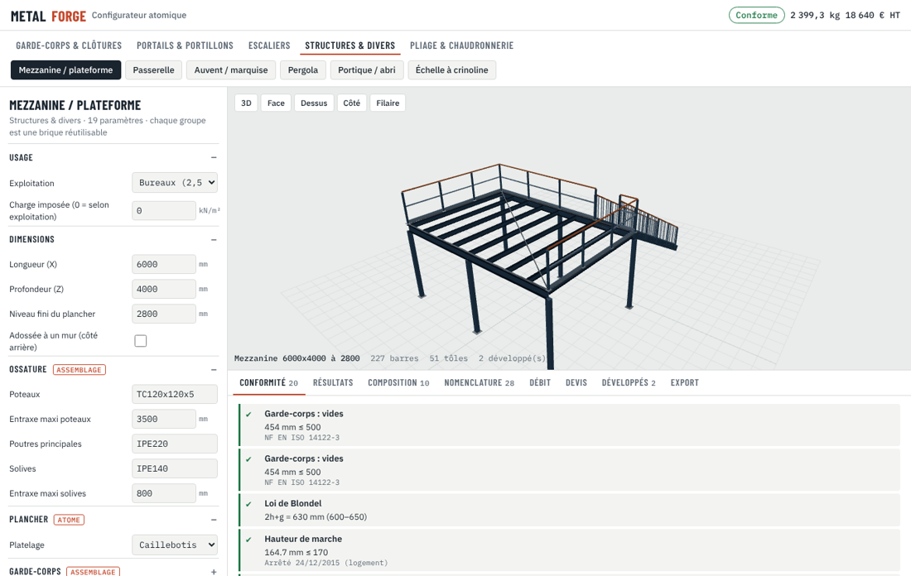
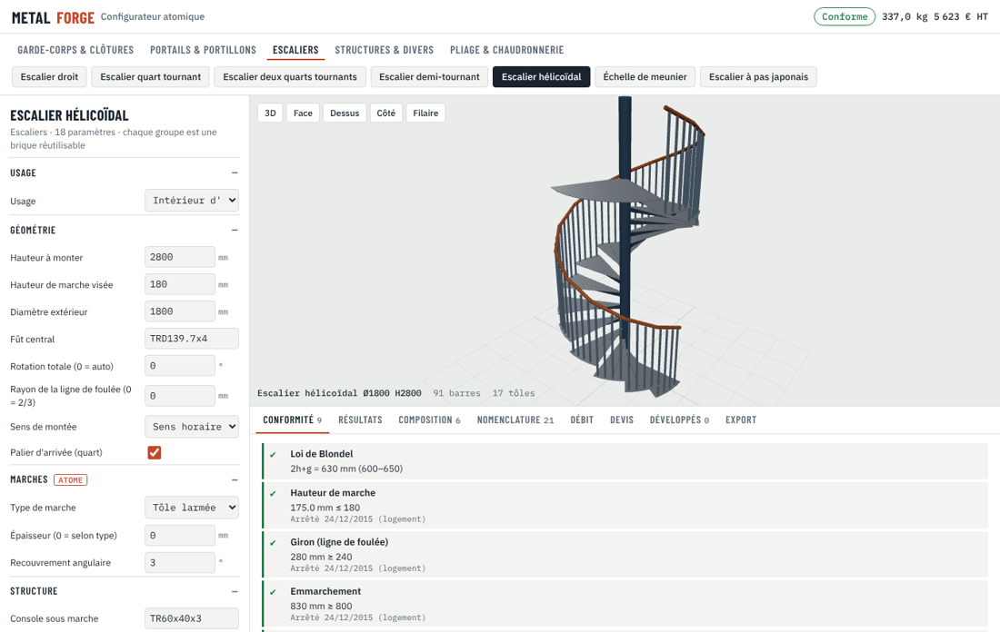
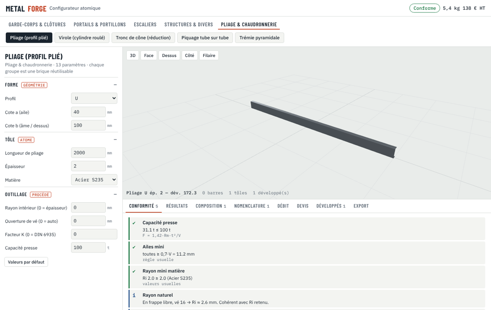
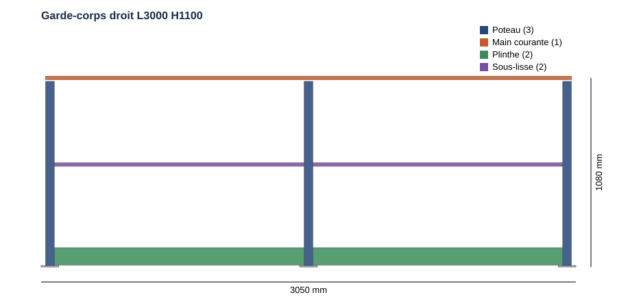
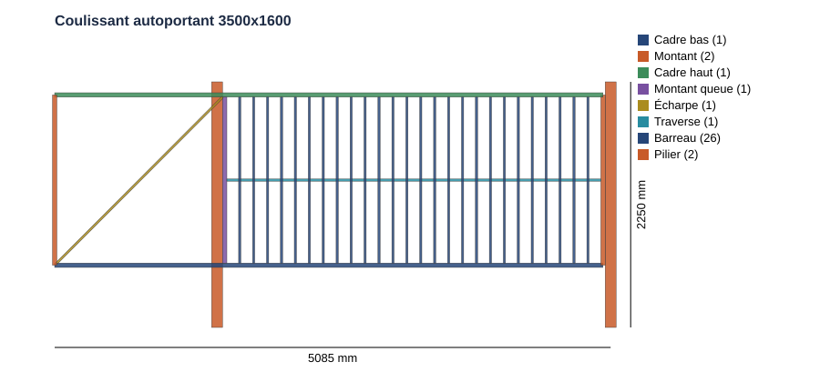
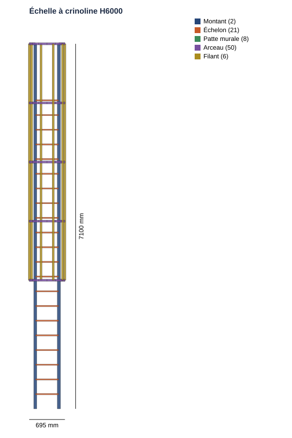
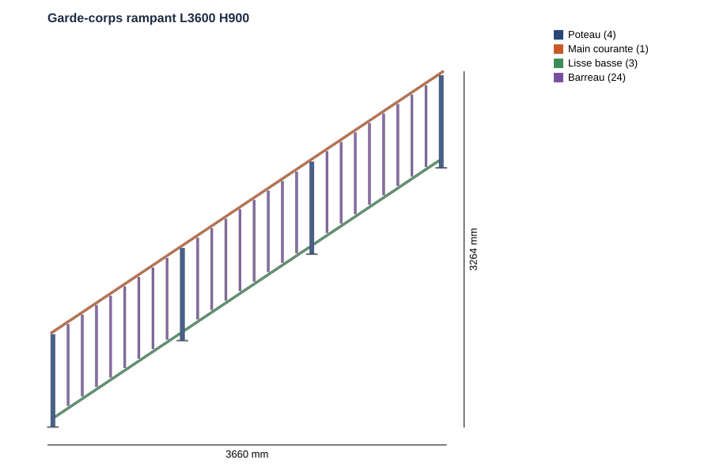
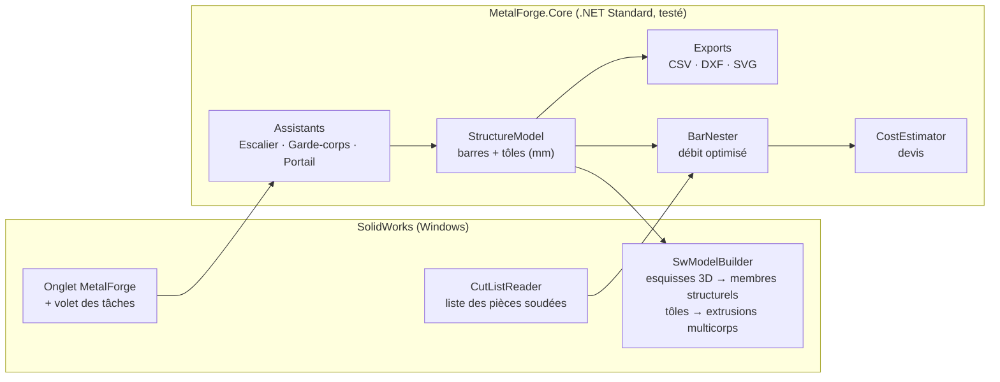

# 🔩 MetalForge — complément SolidWorks pour la métallerie-serrurerie

Complément (add-in) **Windows / SolidWorks** et **configurateur web** qui apportent les fonctions métier d'un logiciel de métallerie
(type MetalCAD, HiCAD Serrurerie, TopSolid'Steel…) : garde-corps, clôtures, portails, escaliers de tous types, structures,
pliage et chaudronnerie, avec contrôles normatifs, débit optimisé, nomenclature, devis et développés DXF.

## 🧩 Configurateur atomique (nouveau)

Un moteur unique de **briques paramétrables** construit **21 ouvrages** :
- **atomes :** profilé, tôle, verre, câble, platine, gond… ;
- **assemblages :** remplissage, travée, cadre, ligne de foulée, limons, crinoline, pli ;
- **ouvrages :** les 21 familles complètes.

Le même moteur tourne dans le navigateur (aperçu 3D, téléphone compris) et dans SolidWorks, où il génère la pièce mécano-soudée.

- ▶️ Ouvrir `web/configurateur/index.html` dans un navigateur, ou la commande **Configurateur** dans SolidWorks.
- 📖 Détail des briques, de l'éventail et des limites : **[docs/CONFIGURATEUR.md](docs/CONFIGURATEUR.md)**.

| Escalier quart tournant balancé | Mezzanine avec escalier intégré |
|---|---|
|  |  |
| **Escalier hélicoïdal** | **Pliage : développé DIN 6935** |
|  |  |

| Famille | Ouvrages |
|---|---|
| Garde-corps & clôtures | garde-corps (droit, L, U, rampant ; 13 remplissages ; 5 poses), clôture (pente, redans) |
| Portails & portillons | battant 1 / 2 vantaux, portillon, coulissant, autoportant ; 5 formes de chapeau |
| Escaliers | droit, quart tournant, deux quarts, demi-tournant (palier ou balancé), hélicoïdal, meunier, pas japonais |
| Structures & divers | mezzanine / plateforme, passerelle, auvent / marquise, pergola, portique / abri, échelle à crinoline |
| Pliage & chaudronnerie | profil plié (9 formes dont personnalisé), virole, tronc de cône, piquage tube sur tube, trémie pyramidale |

> ℹ️ Les fonctionnalités exactes de MetalCAD ne sont pas documentées publiquement. Le périmètre retenu
> couvre les fonctions **cœur de métier** communes à ces logiciels ; il est conçu pour être étendu brique par brique.

## ✨ Assistants détaillés (C#)

| Module | Ce qu'il fait | Sorties |
|---|---|---|
| 🪜 **Escalier droit** | Loi de Blondel, échappée, règles **par usage** (logement, collectif, **ERP neuf**, **industriel 30–38°**), limons tôle ou profilés, marches **tôle pliée**, garde-corps rampant intégré, **résistance des limons et des marches** | Pièce mécano-soudée 3D, **DXF de traçage du limon**, rapport de conformité |
| 🛡️ **Garde-corps** | Usage privé / ERP / **industriel** (lisse + sous-lisse + plinthe), droit ou **rampant**, pose à la française / à l'anglaise, **NF P01-012:2024** (zone basse 600 mm, gabarit T1 110 mm), **résistance** des poteaux et de la main courante (0,6 / 1,0 kN/m), effort par cheville | Pièce 3D, vérifs normatives + calcul |
| 🚪 **Portail / clôture** | Battant 1 ou 2 vantaux, **coulissant autoportant** (queue + écharpe), panneau de clôture, **efforts sur les gonds**, sécurité motorisation (doigts 25 mm, cisaillement au pilier) | Pièce 3D, masse par vantail |
| 🪜 **Échelle à crinoline** | Pas d'échelons constant, crinoline (arceaux, filants), pattes murales, contrôle volée / paliers (NF E85-016, ISO 14122-4) | Pièce 3D, vérifs |
| 📄 **Note de calcul** | Dossier HTML imprimable en PDF : vue, résultats, vérifications, nomenclature, plan de débit, devis, trous d'évent, **textes de référence avec sources** | Fichier HTML |
| 🔥 **Galvanisation** | Trous d'évent par profil creux (NF EN ISO 14713-2) | Onglet + note |
| ✂️ **Débit optimisé** | Optimisation 1D des barres (Best Fit Decreasing), trait de scie, équerrage, **réemploi des chutes** en stock, alerte aboutage | Plan de débit, CSV atelier |
| 📋 **Liste des pièces soudées** | Lecture de la cut-list SolidWorks de **n'importe quelle pièce mécano-soudée** (même non créée par MetalForge), reconnaissance automatique des profils | Débit + devis du modèle actif |
| 💶 **Devis** | Matière achetée (chutes incluses), tôle + laser, temps de coupe/soudure/meulage, peinture / thermolaquage / galva, pose, marge, TVA | Estimation détaillée HT/TTC |
| 📚 **Bibliothèque de profilés** | 123 profilés : tubes EN 10219, ronds, plats, cornières, fers T, UPN, IPE, HEA + tout identifiant bien formé (`TR90x45x3`) | Masse linéique, surface à peindre, fichier `.sldlfp` associé |
| 📐 **Exports** | Nomenclature CSV (Excel FR), DXF R12 (vue de face, limon), SVG | Fichiers prêts pour l'atelier / la découpe |

Toutes les fenêtres recalculent **en direct** : on modifie un paramètre → aperçu, conformité, débit et prix se mettent à jour.

| Garde-corps industriel (ISO 14122-3) | Portail coulissant autoportant |
|---|---|
|  |  |

| Échelle à crinoline | Garde-corps rampant |
|---|---|
|  |  |

---

## 🧱 Architecture



- **`MetalForge.Core`** — tout le calcul métier, sans dépendance à SolidWorks : testable, réutilisable
  (application autonome, service web…), qui exécute aussi le moteur atomique `engine.js` via Jint. **98 tests unitaires C# + 22 tests du moteur JavaScript.**
- **`MetalForge.SwAddin`** — le complément COM (.NET Framework 4.8, x64) : commandes, fenêtres WinForms,
  génération de la géométrie via l'API SolidWorks.

Repère utilisé : **X** = longueur / sens de montée, **Y** = vertical, **Z** = profondeur. Cotes en **mm**.

```
 web/configurateur/
 │   ├─ engine.js        moteur atomique (partagé web / SolidWorks)
 │   ├─ engine.test.js   tests Node
 │   └─ index.html       configurateur 3D (three.js)
 src/
 ├─ MetalForge.Core/
 │   ├─ Atomic/        exécution du moteur (Jint), import du modèle, grille de propriétés
 │   ├─ Profiles/      catalogue, masses EN, reconnaissance des noms SolidWorks
 │   ├─ Stairs/        escalier droit (Blondel, échappée, limons)
 │   ├─ Railings/      garde-corps (NF P01-012)
 │   ├─ Gates/         portails, clôtures
 │   ├─ Ladders/       échelles à crinoline
 │   ├─ Structural/    vérifications Eurocode 3 (pré-dimensionnement)
 │   ├─ Standards/     registre des normes + sources
 │   ├─ Reports/       note de calcul HTML
 │   ├─ Fabrication/   débit optimisé, trous d'évent galvanisation
 │   ├─ Costing/       devis
 │   └─ Export/        CSV, DXF, SVG
 └─ MetalForge.SwAddin/
     ├─ MetalForgeAddin.cs   point d'entrée ISwAddin, onglet, volet des tâches
     ├─ Sw/                  génération 3D, lecture de la liste des pièces soudées
     ├─ UI/                  configurateur (WebView2), fenêtres (paramètres, aperçu, débit, devis)
     ├─ Settings/            réglages (%APPDATA%\MetalForge\settings.xml)
     └─ Install/             register.bat / unregister.bat
 tests/MetalForge.Core.Tests/
```

---

## 🛠️ Installation

**Prérequis** : Windows 10/11 x64, SolidWorks 2018 ou plus récent, Visual Studio 2022 (ou SDK .NET 8 + targeting pack .NET Framework 4.8).

1. **Compiler** (SolidWorks installé à l'emplacement par défaut) :
   ```bat
   dotnet build MetalForge.sln -c Release
   ```
   Autre dossier d'installation :
   `dotnet build MetalForge.sln -c Release -p:SolidWorksDir="D:\SOLIDWORKS Corp\SOLIDWORKS"`
2. **Enregistrer** : clic droit sur `src\MetalForge.SwAddin\bin\Release\net48\register.bat` → *Exécuter en tant qu'administrateur*.
3. **Activer** : SolidWorks → *Outils > Compléments* → cocher **MetalForge** (et « Démarrage »).
4. **Réglages** (onglet MetalForge → *Réglages*) : vérifier le **dossier des profils mécano-soudés**
   (détecté automatiquement depuis *Options > Emplacements des fichiers*).

Désinstallation : `unregister.bat` en administrateur, SolidWorks fermé.

---

## 🚀 Utilisation

1. Onglet **MetalForge** (ou volet des tâches) → **Escalier**, **Garde-corps** ou **Portail**.
2. Renseigner les paramètres à gauche ; l'aperçu, le rapport de conformité, le plan de débit et le devis se mettent à jour.
3. **Générer dans SolidWorks** → nouvelle pièce mécano-soudée : un membre structurel par profilé, les tôles en corps séparés,
   la liste des pièces soudées est prête pour la mise en plan.
4. **Débit & devis** sur n'importe quelle pièce mécano-soudée ouverte : lecture de la liste des pièces soudées → barres optimisées.

### Profils SolidWorks

La géométrie est créée avec les fichiers de profils `.sldlfp` de votre bibliothèque. MetalForge les reconnaît
automatiquement par leur nom (`square tube\40 x 40 x 4.sldlfp` → `TC40x40x4`, `Tube carré 40x40x2`, `UPN 120`…).
Si un profil manque :

- l'esquisse 3D `MF_<profil>` est **quand même créée** → insérer le membre à la main, ou
- créer le profil (*Bibliothèque de conception > weldments*) et/ou l'associer dans *Réglages > Associations manuelles*.

La fenêtre **Profilés** indique pour chaque profilé s'il est trouvé (✓) ou non (✗).

---

## ⚖️ Règles vérifiées

➡️ Détail, valeurs, niveau de fiabilité et sources : **[docs/NORMES.md](docs/NORMES.md)** — exemples de notes de calcul dans [docs/exemples](docs/exemples).

| Ouvrage | Règle | Référence |
|---|---|---|
| Escalier | 600 ≤ 2h + g ≤ 650 mm | Loi de Blondel |
| Escalier habitation | h 150–200 mm, g ≥ 240 mm (210 mini), emmarchement ≥ 800 mm, pente ≤ 42° | Usages / DTU |
| Escalier ERP neuf | h ≤ 160 mm, g ≥ 280 mm, largeur ≥ 1 200 mm, mains courantes 2 côtés 800–1000 mm | Arrêté du 20/04/2017 |
| Escalier logement | intérieur : h ≤ 180, g ≥ 240, l ≥ 800 ; collectif : h ≤ 170, g ≥ 280 | Arrêté du 24/12/2015 |
| Escalier industriel | pente **30–38°**, 600 ≤ g+2h ≤ 660, recouvrement ≥ 10 mm | NF EN ISO 14122-3 |
| Limons / marches | contrainte ≤ fy, flèche L/300 (limon), L/250 (marche) | NF EN 1993-1-1 |
| Escalier | échappée ≥ 2 000 mm (1 900 toléré) | Usage |
| Garde-corps | H ≥ 1 000 mm (800 si épaisseur ≥ 500, 900 en rampant), gabarit T1 110 mm, jeu bas ≤ 110 mm, **zone basse 0–600 mm** non escaladable | NF P01-012:2024 |
| Garde-corps (charges) | 0,6 kN/m privé, 1,0 kN/m public ; poteau, main courante, chevilles | NF P06-111-2/A1, NF EN 1993-1-1 |
| Garde-corps industriel | lisse 1000–1100 mm, sous-lisse (vides ≤ 500), plinthe ≥ 100 mm | NF EN ISO 14122-3 |
| Échelle fixe | pas 225–300, largeur 400–600, crinoline 2,2–3 m, arceaux ≤ 1,5 m, filants < 300, volée ≤ 8 m | NF E85-016 / ISO 14122-4 |
| Portail | vides barreaux, masse vantail, gonds, queue autoportant ≥ 40 %, jeux ≥ 25 mm si motorisé | NF EN ISO 13854, NF EN 12604 / 12453 |

> ⚠️ Ces contrôles sont une **aide à la conception**. Ils ne remplacent ni la lecture des normes en vigueur,
> ni une note de calcul de résistance (poussée sur garde-corps NF P06-111-2, flèche des limons, etc.).

---

## 🧪 Tests

```bash
node web/configurateur/engine.test.js     # moteur atomique (21 familles, normes, développés)
dotnet test tests/MetalForge.Core.Tests   # moteur C# + exécution du moteur JS par Jint
```

Le moteur (`MetalForge.Core`) est testé sur Linux/Windows/macOS (intégration continue GitHub Actions).
Le complément SolidWorks nécessite Windows et une licence SolidWorks pour être exécuté.

---

## 🗺️ Évolutions prévues

- Escaliers **quart tournant / hélicoïdaux**, paliers, marches balancées
- Paliers de repos et volées décalées pour les échelles > 8 m
- Garde-corps **vitrés** (pinces, profils U) et câbles inox
- **Mise en plan automatique** (vues, nomenclature, bulles) et fiches de débit PDF
- Export **DSTV/NC1** pour scies et lignes de perçage CNC
- Génération automatique des fichiers `.sldlfp` manquants
- Assemblages multi-ouvrages et chiffrage d'affaire
