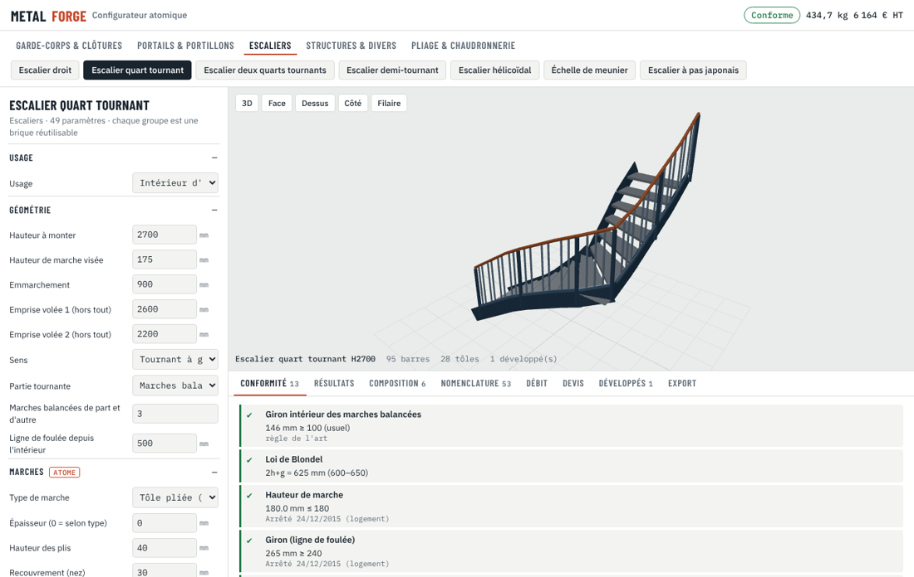
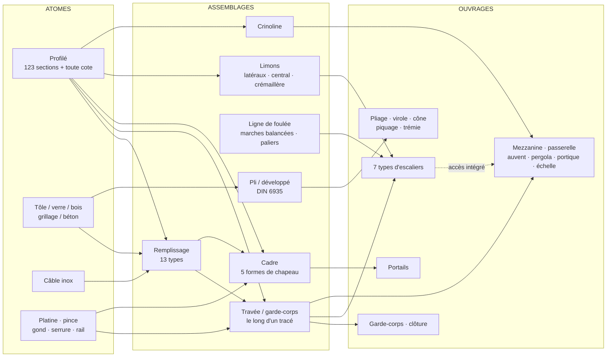
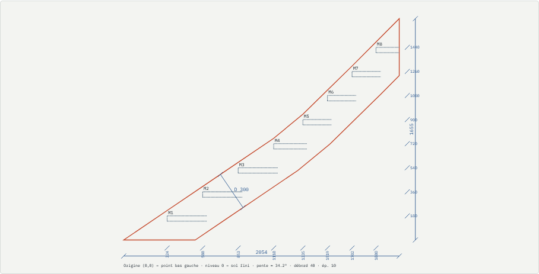

# 🧩 Configurateur atomique MetalForge

Un **seul moteur** de briques paramétrables construit tous les ouvrages. Il est utilisé à deux endroits :

| Où | Comment | Pour quoi faire |
|---|---|---|
| 🌐 **Navigateur / téléphone** | `web/configurateur/index.html` (3D three.js) | chiffrer et montrer au client, vérifier la conformité, sortir les développés |
| 🛠️ **SolidWorks** | même page dans une fenêtre WebView2, commande **Configurateur** | **Générer** la pièce mécano-soudée (membres structurels + tôles) |
| ⚙️ **C# / tests** | `MetalForge.Core.Atomic.ConfiguratorEngine` exécute `engine.js` avec Jint | débit, devis, note de calcul, repli sans WebView2 |

Le même fichier `engine.js` sert dans les trois cas. Les tests C# vérifient que le modèle importé en C# a la même masse que celle calculée par le moteur JavaScript (écart ≤ 4 %, toutes familles).



---

## ⚛️ Atomes → assemblages → ouvrages



Les assemblages se réutilisent entre ouvrages :
- le **remplissage** sert dans le garde-corps, la clôture, le portail, le rampant d'escalier et la mezzanine ;
- le **garde-corps le long d'un tracé** suit aussi bien un balcon en U que le limon d'un escalier balancé ;
- la **mezzanine** intègre un escalier droit ou une échelle complète, avec leurs propres vérifications.

---

## 📦 Éventail

### Garde-corps & clôtures
- **Tracé :** droit, en L, en U, rampant.
- **Pose :**
  - à la française (platine) ;
  - à l'anglaise (platine latérale) ;
  - à l'anglaise avec déport ;
  - scellement ;
  - verre encastré en pied (profil U, sans poteau).
- **Main courante :** filante sur les poteaux ou entre poteaux. Lisse basse en option.
- **Remplissages (13) :**
  - barreaudage vertical, lisses, câbles inox (horizontaux ou verticaux) ;
  - lames / claustra (inclinables), croisillons ;
  - tôle pleine, tôle perforée, tôle découpée laser (motifs) ;
  - verre feuilleté 44.2 à 88.2 (pinces, parcloses, encastré), grillage / treillis soudé ;
  - **mixte** (soubassement + partie haute, chacun au choix) ;
  - industriel (lisse + sous-lisse + plinthe), aucun.
- **Contrôles :**
  - NF P01-012:2024 : hauteur, gabarit Ø 110, zone basse 0–600 mm, câbles tendus ;
  - ISO 14122-3 en industriel ;
  - résistance des poteaux et de la main courante, effort par cheville.
- **Clôture :** terrain en pente avec panneaux rampants ou en redans, barreaux à pointes, scellement ≥ H/3.

### Portails & portillons
- **Types :** battant 1 ou 2 vantaux, portillon, coulissant sur rail, autoportant (queue + écharpe, chariots).
- **Formes du haut :** droit, cintré, chapeau de gendarme, concave, en biais (flèche réglable).
- **Cadre :** traverses intermédiaires, écharpe, barreaux traversants ou à pointes. Tous les remplissages ci-dessus.
- **Quincaillerie :** gonds, serrure, butée, rail, piliers.
- **Calculs et contrôles :**
  - efforts horizontaux par gond ;
  - sécurité motorisation : doigts 25 mm (ISO 13854), cisaillement au pilier, NF EN 12453.

### Escaliers (tous types)

| Type | Particularités |
|---|---|
| Droit | Blondel ou reculement imposé, échappée sous trémie, **développé du limon tôle** |
| Quart tournant | gauche / droite, **marches balancées** (nombre réglable) ou **palier** |
| Deux quarts tournants | volée intermédiaire, paliers ou balancement |
| Demi-tournant | palier intermédiaire unique ou balancement, jour réglable |
| Hélicoïdal | fût central, rotation auto, ligne de foulée, palier d'arrivée, échappée après une révolution |
| Échelle de meunier | 45–75°, mains courantes deux côtés |
| Pas japonais | pas alternés sur limon central |

Options communes :
- **Marches :** tôle larmée, **tôle pliée** (développé fourni), caillebotis, bois, cassette béton.
- **Limons :** deux limons latéraux, limon central avec consoles, crémaillères, limon extérieur seul.
- **Garde-corps :** rampant intérieur, extérieur ou les deux, avec tous les remplissages compatibles.
- **Règles par usage :**
  - logement : h ≤ 180, g ≥ 240 ;
  - logement collectif : h ≤ 170, g ≥ 280 ;
  - ERP neuf : h ≤ 160, g ≥ 280, largeur 1,20 m, mains courantes des deux côtés ;
  - industriel : 30–38°.
- **Contrôles toujours appliqués :** Blondel et giron intérieur des marches balancées.
- **Résistance :** limons et marches.

### Structures & divers
- **Mezzanine / plateforme :** trame de poteaux, poutres, solives, platelage, garde-corps, ouverture d'accès, **escalier droit ou échelle intégrés**. Vérifications : solives, poutres (flèche L/300), flambement des poteaux (Eurocode 3, courbe c).
- **Passerelle :** poutres de rive, traverses, platelage, garde-corps industriels, appuis.
- **Auvent / marquise :** consoles, tirants (effort calculé), couverture verre, tôle ou polycarbonate.
- **Pergola :** autoportante ou adossée, lames orientables.
- **Portique / abri :** travées, 2 pans ou monopente, pannes, croix de contreventement.
- **Échelle à crinoline :** NF E85-016 ou ISO 14122-4.

### Pliage & chaudronnerie
- **Pliage :**
  - profils : cornière, U, Z, oméga, cassette, couvertine, bavette, ourlet 180°, **profil personnalisé** (suite « aile, angle, aile… ») ;
  - développé DIN 6935 (facteur K automatique ou imposé) ;
  - position des plis, effort de presse F = 1,42·Rm·t²/V ;
  - aile mini 0,7·V, rayon mini matière, rayon naturel en frappe libre.
- **Virole :** diamètre intérieur, extérieur ou moyen ; découpe en plusieurs tôles ; rapport D/t.
- **Tronc de cône :** rayons de traçage, angle, corde ; découpe en n secteurs.
- **Piquage tube sur tube :** angle quelconque ; **gabarit de coupe** et **trou du collecteur** développés.
- **Trémie pyramidale :** faces en vraie grandeur, arête vraie, pente d'écoulement.

Tous les développés s'exportent en **DXF R12** (calques `DECOUPE`, `PLIAGE`, `TRACAGE`, `TEXTE`).

---

## 🤖 Mode automatique

- **Dimensionnement automatique :**
  - les profils structurels sont réglés par défaut sur **Auto — le plus léger conforme** : poteaux de garde-corps, limons, poutres, solives, poteaux de mezzanine, poutres de passerelle, consoles et tirants d'auvent, traverses de portique, échelons ;
  - le moteur essaie la série du plus léger au plus lourd (recherche dichotomique) et garde le premier profil qui satisfait les vérifications de résistance qui le concernent ;
  - le profil retenu s'affiche sous la liste (« → Tube carré 50x50x2 ») et dans *Résultats*.
- **Règles de construction** ajoutées au calcul : hauteur mini du limon (débord + marche + 100 mm) et épaisseur ≥ 8 mm.
- **Profil imposé :** choisir un profil dans la liste désactive l'auto pour ce paramètre ; les vérifications signalent alors s'il ne passe pas.

## 📋 Listes déroulantes complètes

Chaque profilé est choisi dans une **liste groupée par famille**, avec sa masse linéique. Une entrée « Autre profil (saisie libre) » accepte toute cote.

| Groupe | Exemples |
|---|---|
| Mains courantes moulurées | demi-ronde 40x8 à 60x12, bombée, moulurée 40x30 à 60x45, creuse à gorge |
| Mains courantes bois | 45x45, 50x40, 60x40, 70x45, 80x50 |
| Tubes ronds acier / inox | Ø12 à Ø168,3 · inox Ø25 à Ø50,8 |
| Tubes ovales et oblongs | ovale 50x25 à 80x40, oblong 40x20 à 80x30 |
| Tubes carrés / rectangulaires | 15x15 à 200x200, 30x15 à 200x100 |
| Plats | 20x3 à 400x20 |
| Ronds, carrés pleins, **carrés torsadés** | Ø6 à Ø50, 8 à 40, torsadés 12 à 20 |
| Profils U (lisse sur verre), câbles inox | U 30x30 à 60x45, câbles Ø3 à Ø10 |
| Cornières, fers T, UPN, IPE, HEA, HEB | séries usuelles |

Les autres listes sont aussi complétées :
- **Remplissages (22) :** + barreaudage rythmé, barreaux à lances, métal déployé, tôle ondulée, lames bois, verre opale, polycarbonate, panneau composite, filet inox.
- **Poses :** + sabot en applique, encastré en réservation.
- **Chapeaux de portail :** + double cintre, chapeau de gendarme inversé, fronton.
- **Marches :** + tôle perforée, caillebotis pressé, bois sur cassette, pierre, verre.
- **Platelages :** + caillebotis pressé, tôle perforée, composite, plancher collaborant.
- **Finitions de rendu :** RAL 7016, 9005, noir sablé, 9010, 7035, 7022, 6005, 3004, 5003, 1015, 8019, galvanisé, inox brossé, Corten.

## 🧱 Maçonnerie de contexte

Chaque ouvrage peut être posé dans son contexte maçonné, pour un rendu et une implantation fiables :

| Ouvrage | Maçonnerie générée |
|---|---|
| Garde-corps | dalle + revêtement, balcon + façade avec porte-fenêtre, muret / allège, toiture-terrasse + acrotère, escalier béton sous rampant |
| Clôture | muret de soubassement (redans) + chaperon, piliers maçonnés + chapeaux, sol |
| Portail | piliers maçonnés + chapeaux, murs de clôture latéraux, allée |
| Escaliers | dalle basse, **plancher haut avec trémie** (longueur réelle pour l'escalier droit), murs d'échiffre, cage maçonnée (hélicoïdal), **main courante murale** sur supports |
| Mezzanine, passerelle, auvent, pergola, portique, échelle | dalle et sol, mur d'adossement, culées, façade avec porte et seuil, terrasse, toiture-terrasse + acrotère |

- **Matériaux :** béton banché ou brut, parpaing brut ou enduit, brique, brique rouge, pierre de taille, moellons, enduits, bardage bois, béton ciré.
- **Sols :** béton, carrelage, parquet, résine, enrobé, pavés, gravier, gazon, terrasse bois, dallage pierre.
- **Rendu 3D :** textures procédurales à l'échelle (blocs 20x50, briques, appareil de pierre…), ombres portées, et planchers hauts semi-transparents pour voir l'escalier. Le bouton **Maçonnerie** masque ou affiche le contexte.

Contrôles liés à la maçonnerie :
- **Garde-corps sur muret :** la hauteur de protection = muret + garde-corps si l'arase est à 600 mm ou plus. En dessous, elle se mesure depuis l'arase (interprétation à confirmer).
- **Main courante murale :** signalée s'il n'y a pas de mur de ce côté.

Dans SolidWorks, la maçonnerie est créée dans une **pièce séparée** (*Réglages › Générer la maçonnerie*), pour ne pas polluer la liste des pièces soudées.

## 📐 Limons et traçage

Les limons en **plat** sont modélisés en **tôle découpée** pour tous les escaliers à volées (droit, quart tournant, deux quarts, demi-tournant) :

- **Contour :** coupe d'aplomb au sol, coupe verticale au chevêtre, ressaut aux paliers ; un tronçon par côté droit du bord.
- **Développé par tronçon :** traits du dessus et du dessous de chaque marche (calque TRACAGE), repères M1, M2…, et **tableau des cotes de traçage** (position du nez, hauteur, profondeur).
- **Onglet Développés :**
  - copier le DXF de tous les développés ou d'un seul ;
  - copier les cotes en CSV ;
  - dans SolidWorks, enregistrer le DXF.

- **Cotation complète de chaque développé** (écran, DXF calque COTES, SolidWorks) :
  - longueur et hauteur hors tout ;
  - position cumulée de chaque nez depuis l'origine, niveau de chaque marche ;
  - largeur D perpendiculaire à la rive (ou hauteur verticale sur les petits tronçons d'angle) ;
  - tableau des **points de découpe** P1, P2… (x, y), exporté avec les cotes de traçage en CSV.
- **Géométrie contrôlée automatiquement** (`stringer-check.js`, 360 développés et leurs raccords testés à chaque livraison) :
  - aucun contour croisé, rien sous le sol ;
  - largeur constante D, sans zone mince ;
  - rive haute à la cote de débord au-dessus de chaque nez ;
  - chaque marche portée, 20 mm au moins sous la rive basse ;
  - raccords d'angle sans ressaut, ou arrêt voulu sur poteau d'angle.



Les limons profilés (UPN, tubes) restent des barres, posées au sol, avec coupes d'about à ajuster.

---

## 🛠️ Dans SolidWorks

1. Onglet **MetalForge → Configurateur** : la page s'ouvre dans SolidWorks.
2. Régler l'ouvrage, puis **Export → Générer dans SolidWorks**.
3. La pièce mécano-soudée est créée :
   - une esquisse 3D et un membre structurel par profilé ;
   - les tôles sur le plan de face, de dessus ou de droite, chacune en corps séparé.
4. **Enregistrer le DXF / la nomenclature** depuis la même page.

Si le runtime **Microsoft Edge WebView2** est absent, la commande ouvre la grille de propriétés classique. Elle utilise le même moteur et les mêmes familles, avec les onglets aperçu, débit, devis et note de calcul.

> ⚠️ Points à connaître :
> - L'aperçu 3D charge three.js depuis le CDN jsDelivr : il faut une connexion internet.
> - Les surfaces de révolution (virole, cône, piquage, trémie) ne sont pas générées en volume SolidWorks. Les créer en **Tôlerie** (pli lofté, bride de base) à partir du DXF fourni.

---

## ➕ Ajouter une brique ou un ouvrage

Dans `web/configurateur/engine.js` :

```js
family({
  id: 'mon-ouvrage', cat: 'Structures & divers', label: 'Mon ouvrage', icon: 'frame',
  params: [ { k: 'L', l: 'Longueur', t: 'num', d: 2000, u: 'mm', g: 'Dimensions' } ],
  build: function (p) {
    var m = new Model('Mon ouvrage ' + p.L);
    m.member('P', 'Poteau', 'TC60x60x3', [0, 0, 0], [0, 1000, 0]);   // atome profilé
    infill(m, panneau, { type: 'barreaux', gap: 110 });               // assemblage réutilisé
    m.rule(p.L <= 3000, 'Portée', 'OK', 'trop longue', 'référence');  // contrôle
    return m;
  }
});
```

L'interface web, la grille WinForms, l'export SolidWorks et les tests se mettent à jour automatiquement à partir du schéma `params`. Tests : `node web/configurateur/engine.test.js` puis `dotnet test`.
