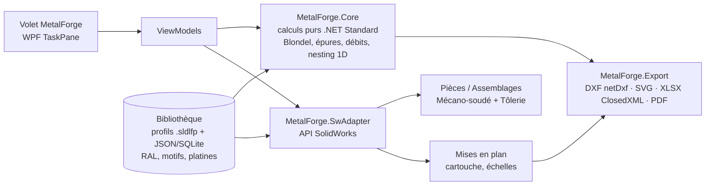

# Spécification MetalForge — complément SolidWorks inspiré de MétalCad

## 1. Objectif
Reproduire **dans SolidWorks** (complément Windows) les automatismes métier de MétalCad pour la métallerie/serrurerie : escaliers, garde-corps, portails, clôtures, menuiseries acier, platines, avec génération automatique des **développés**, **débits**, **mises en barres**, **exports DXF/SVG** et **impressions PDF à l'échelle (1:1, 1:10…) en A4/A3/A2/A1/A0**.

SolidWorks remplace MédiaCad (DAO) : on ne recode **pas** de moteur de dessin, on pilote l'API SolidWorks.

## 2. Architecture

| Projet (solution `MetalForge.sln`) | Rôle | Cible |
|---|---|---|
| `MetalForge.Core` | Modèle de domaine + calculs **sans dépendance SolidWorks** (testable) | .NET Standard 2.0 |
| `MetalForge.SwAdapter` | Création de géométrie via API SW (esquisses, membres mécano-soudés, tôlerie, configurations) | .NET Framework 4.8 |
| `MetalForge.AddIn` | `ISwAddin`, enregistrement COM, commandes, TaskPane WPF | .NET Framework 4.8, x64 |
| `MetalForge.Export` | DXF (netDxf), SVG, XLSX (ClosedXML), PDF via mise en plan SW | .NET Standard 2.0 / 4.8 |
| `MetalForge.Library` | Gestion bibliothèque (profils, RAL, motifs, platines, modèles/album) | .NET Standard 2.0 |
| `MetalForge.Tests` | xUnit — tests unitaires du Core | .NET 8 |

Option à évaluer : **xCAD.NET** (Xarial) pour simplifier l'enregistrement et les TaskPanes.

### Correspondance MétalCad → SolidWorks natif
| Besoin MétalCad | Outil SolidWorks à exploiter |
|---|---|
| Sections du commerce, garde-corps, portails, cadres | **Mécano-soudé** (Structure Member) + profils `.sldlfp` (bibliothèque perso + fournisseurs) |
| Feuille de débit | **Liste des pièces soudées** (Cut List) → propriétés → export XLSX |
| Limons tôle, marches pliées, platines, tôles découpées | **Tôlerie** (Base Flange, Edge Flange) → **déplié** → `ExportToDWG2` DXF |
| Album / catalogue | **Configurations** + **Design Table** + fichiers modèles JSON |
| Cartouche, échelles | Fond de plan `.slddrt` + modèle `.drwdot`, propriétés personnalisées |
| Rendu, RAL | Apparences + PhotoView 360 / Visualize ; RAL en table d'apparences |
| Insertion sur photo | Décor/Scène avec image de fond (phase ultérieure) |
| Import relevé DWG / x,y,z | Import DXF en esquisse ; lecture CSV x,y,z → esquisse 3D |

## 3. Lots de développement (priorités)

| Lot | Contenu | IDs inventaire | Critères d'acceptation |
|---|---|---|---|
| **L0** | Squelette solution, add-in chargé, TaskPane vide, journalisation, CI build | F-GEN-03 | Add-in visible dans *Outils > Compléments* SW 2022+ |
| **L1 — MVP Escalier** | Moteur de calcul escalier droit + quart tournant balancé (méthode de balancement à définir : épure / quartier tournant) ; limons à la française tôle gauche + droit ; marches tôle pliée / bois | F-ESC-01/02/05/10-15/20/23/28/30 | Génère pièce + assemblage paramétré ; **développés limons G+D** en DXF/SVG relisibles par SW ; **PDF 1:1 et 1:10** en A4/A3/A2/A1/A0 (tuilage A4 pour le 1:1) |
| L2 | Garde-corps droits/rampants, barreaudage, lisses, câbles, verre ; implantation sur tracé 2D ; gestion des angles | F-GC-01..08 | Débit + mise en barres sur cas test |
| L3 | Portails battants/coulissants/portillons + clôtures sur terrain en pente | F-PO-*, F-CL-* | Respect des jeux, saisie entre piliers |
| L4 | Platines (album réutilisable), mise en barres 1D (trait de coupe, RAL, multi-projets), feuille de débit XLSX | F-PL-*, F-PR-04/05 | Taux de chute affiché, liste d'approvisionnement |
| L5 | Hélicoïdal avec fût, crémaillère, limon central, UPN, caissonné | F-ESC-03/04/06/21/22/24 | — |
| L6 | Menuiseries acier (élévation, coupes, profils DWG importés) | F-ME-* | — |
| L7 | Motifs de découpe (vectorisation bitmap → esquisse), rendu RAL, export IFC | F-PR-06/07/10/13 | — |

## 4. Exigences transverses
- **Paramétrique** : chaque ouvrage = objet `*Definition` sérialisable JSON (`.mfg.json`) → régénère la géométrie ; jamais de géométrie « morte ».
- **Unités** : mm en interne ; l'API SW travaille en **mètres** → conversion centralisée (`Units.MmToM`).
- **Arbre de construction** nommé en français (`Limon_G`, `Marche_01`, `Esquisse_Epure`…).
- **Profils de règles** : Maison individuelle / Habitat collectif / ERP / Personnalisé (cf. `03_REGLES_METIER.md`).
- **Cote imposée** (F-GEN-09) : verrouillage d'une valeur, le solveur ajuste les autres.
- **Exports** : DXF R2013 (calques : `CONTOUR`, `PERCAGE`, `GRAVURE_MARQUAGE`, `COTATION`, `TEXTE`) ; SVG 1:1 en mm (`viewBox` en mm) ; PDF vectoriel.
- **Impression à l'échelle** : choix échelle × format, calcul automatique du nombre de feuilles, repères de raccord et mire de contrôle 100 mm.
- **Localisation** : interface FR ; noms de propriétés personnalisées FR.
- **Robustesse** : toutes les opérations SW dans une transaction logique (annulation si échec), `EditRebuild3` en fin.

## 5. Interdits (propriété intellectuelle)
Les captures de `captures/` servent **uniquement** à comprendre les fonctions. Ne pas copier : icônes, textes, catalogues, book de découpes, polices, noms commerciaux MétalCad/MétaluSoft. Les bibliothèques fournisseurs se constituent à partir des **catalogues publics des fabricants** ou de profils normalisés (EN 10025, EN 10219, EN 10279 UPN…).
