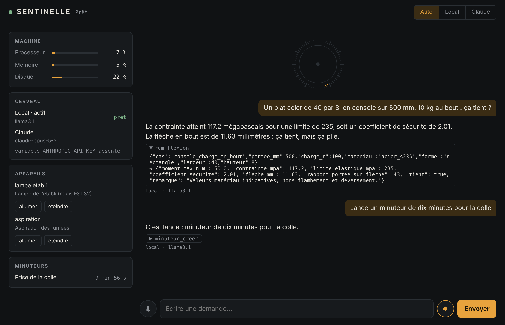
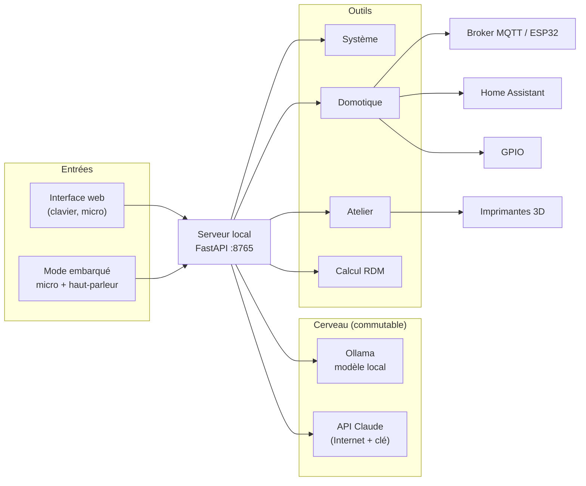

# Sanctuary-GCSI — Sentinelle

Création d'un écosystème souverain. Première brique : **Sentinelle**, un assistant vocal d'atelier
qui tourne chez vous, sur votre PC ou un Raspberry Pi, et qui agit sur votre installation.

L'idée de départ est l'assistant de fiction que tout le monde connaît. Sentinelle en reprend le
principe — on parle, il répond et il agit — avec un nom, une voix et une interface qui lui sont propres.



## Ce qu'il sait faire

| Domaine | Outils |
|---|---|
| Conversation vocale | Mot d'activation, écoute et parole hors ligne (Vosk + Piper), ou micro du navigateur |
| Système | Heure, état de la machine, météo, minuteurs, notes |
| Domotique | MQTT (ESP32, Zigbee2MQTT…), Home Assistant, relais sur GPIO du Raspberry Pi |
| Atelier | Suivi d'imprimantes (Bambu Lab en LAN, OctoPrint, Klipper/Moonraker), nomenclatures avec export CSV |
| Calcul | Sections, flexion de poutre, vis ISO, masse, coût d'impression |

## Architecture



Le cerveau décide quel outil appeler ; le serveur l'exécute et lui rend le résultat. Les deux
cerveaux partagent exactement les mêmes outils, et l'on bascule de l'un à l'autre en cours de
conversation (boutons *Auto / Local / Claude*). En mode *Auto*, le local passe en premier.

## Installation

```bash
git clone https://github.com/estilinguierre/Sanctuary-GCSI.git && cd Sanctuary-GCSI
python3 -m venv .venv && .venv/bin/pip install -e ".[dev]"
cp config.exemple.toml config.toml        # puis adapter
.venv/bin/python -m sentinelle.serveur    # http://127.0.0.1:8765/
```

Python 3.11 ou plus récent.

### Le cerveau

- **Local** : installer [Ollama](https://ollama.com), puis `ollama pull llama3.1` (ou tout modèle
  sachant appeler des outils, à déclarer dans `config.toml`). Rien ne sort de la machine.
- **Claude** : `export ANTHROPIC_API_KEY=…` avant de lancer le serveur. Modèle `claude-opus-5-5`,
  effort `low` par défaut pour répondre vite. Si le modèle décline une demande pour raison de
  politique, l'API la rejoue automatiquement sur un modèle de repli (option `fallbacks`).

### La voix

Dans le navigateur, la parole utilise la synthèse du système. Pour l'écoute, deux voies :

1. **Locale (recommandée)** : `pip install -e ".[voix]"`, puis décompresser le modèle français
   `vosk-model-small-fr-0.22` (alphacephei.com/vosk/models) dans `modeles/`. Le HUD enregistre,
   le serveur transcrit.
2. **Navigateur** : sans Vosk, le HUD se rabat sur la reconnaissance du navigateur, qui chez
   certains éditeurs envoie l'audio sur leurs serveurs.

Un navigateur n'ouvre le micro que sur `localhost` ou en HTTPS.

### Mode embarqué (Raspberry Pi, cyberdeck)

```bash
sudo apt install espeak-ng portaudio19-dev alsa-utils
.venv/bin/pip install -e ".[voix,pi]"
.venv/bin/python -m sentinelle.voix       # le serveur doit tourner
```

Dites « Sentinelle, quelle heure est-il ? », ou « Sentinelle » seul puis la demande. Pour une voix
plus naturelle, installer [Piper](https://github.com/rhasspy/piper) et placer une voix française
(`.onnx` et `.onnx.json`) dans `modeles/` ; sinon `espeak-ng` est utilisé. Deux unités systemd
sont fournies dans `deploiement/` pour un démarrage automatique. Matériel conseillé :
[docs/materiel.md](docs/materiel.md).

## Configuration

Tout est dans `config.toml` (voir `config.exemple.toml`, commenté). Les secrets ne s'y écrivent
jamais : ils passent par des variables d'environnement.

| Variable | Rôle |
|---|---|
| `ANTHROPIC_API_KEY` | Cerveau Claude |
| `SENTINELLE_JETON` | Jeton d'accès, obligatoire hors `127.0.0.1` |
| `MQTT_MOT_DE_PASSE`, `HA_JETON` | Broker MQTT, Home Assistant |
| `OCTOPRINT_CLE_<NOM>`, `BAMBU_CODE_<NOM>` | Imprimantes |

## Sécurité

- L'assistant ne commande que les appareils listés dans `config.toml`, avec les seules actions
  déclarées. Il ne peut pas publier sur un topic MQTT arbitraire.
- Le serveur n'écoute que sur `127.0.0.1` par défaut et refuse de démarrer sur le réseau sans
  jeton. Avec un jeton, ouvrir `http://<adresse>:8765/?jeton=…`.
- Les imprimantes sont en lecture seule.
- Les calculs RDM sont un pré-dimensionnement d'atelier avec des valeurs matériaux indicatives.
  Ils ne remplacent pas une note de calcul pour un ouvrage qui engage la sécurité des personnes.

## Ajouter un outil

Un outil est une fonction décorée dans `sentinelle/outils/` ; il devient aussitôt disponible
pour les deux cerveaux.

```python
@outil("volume_cylindre", "Volume d'un cylindre en centimètres cubes.",
       {"diametre_mm": {"type": "number"}, "hauteur_mm": {"type": "number"}},
       ["diametre_mm", "hauteur_mm"])
def volume_cylindre(ctx, diametre_mm, hauteur_mm):
    return {"volume_cm3": round(math.pi * diametre_mm**2 / 4 * hauteur_mm / 1000, 2)}
```

## Tests

```bash
.venv/bin/python -m pytest
```

Les tests couvrent les outils, les formules RDM (contre des valeurs calculées à la main), la
boucle d'outils des deux cerveaux, l'API et la logique du mot d'activation. Les services
extérieurs y sont simulés : l'API Claude réelle, un vrai Ollama, la chaîne audio Vosk/Piper et le
matériel (MQTT, GPIO, Home Assistant, imprimantes) restent à valider sur votre installation.
